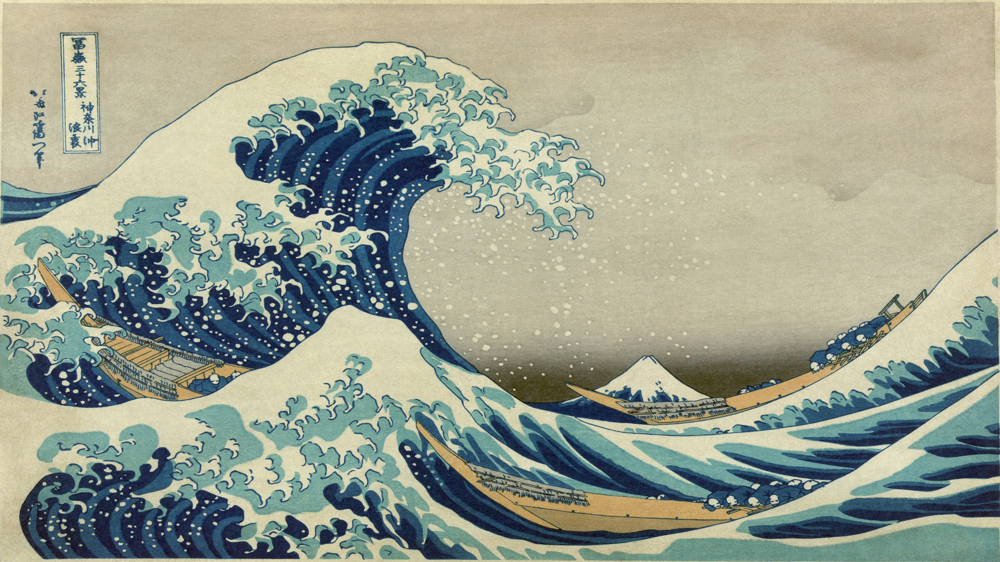

# Thirty-six Views of Mount Fuji — an Omarchy theme

An [Omarchy](https://omarchy.org) theme built on the stock Kanagawa palette, with all
46 prints of Katsushika Hokusai's *Thirty-six Views of Mount Fuji* (冨嶽三十六景,
*Fugaku Sanjūrokkei*, c. 1830–1832) as backgrounds, in series order.



## Install

Clone the repo somewhere out of the way and symlink it into your themes folder:

```bash
git clone https://github.com/MirasMustimov/omarchy-thirty-six-views-of-mount-fuji-theme.git \
  ~/.local/share/omarchy-themes/omarchy-thirty-six-views-of-mount-fuji-theme
ln -s ~/.local/share/omarchy-themes/omarchy-thirty-six-views-of-mount-fuji-theme \
  ~/.config/omarchy/themes/thirty-six-views-of-mount-fuji
omarchy theme set thirty-six-views-of-mount-fuji
```

Cycle through the prints with `omarchy theme bg next`. Update with `git pull` in the
cloned folder.

`omarchy theme install <url>` also works, but Omarchy drops a downloaded theme's
`hyprland.lua`, `neovim.lua` and `vscode.json`, so you lose the parchment window border,
the terminal opacity tweak, and the kanagawa colorschemes for Neovim and VS Code. The
symlink install keeps everything.

The repo is about 150 MB: the backgrounds are 3840×2160 JPEGs.

## Uninstall

Switch to another theme first, then remove the symlink and the clone:

```bash
omarchy theme set kanagawa   # or any other theme
rm ~/.config/omarchy/themes/thirty-six-views-of-mount-fuji
rm -rf ~/.local/share/omarchy-themes/omarchy-thirty-six-views-of-mount-fuji-theme
```

Leave the trailing slash off the first `rm` so it removes the link, not the files it
points to. If you used `omarchy theme install`, the theme is a plain folder: run
`rm -rf ~/.config/omarchy/themes/thirty-six-views-of-mount-fuji` instead.

## What's in it

- `colors.toml`, `icons.theme`, `vscode.json` — from Omarchy's Kanagawa theme
- `hyprland.lua` — parchment active border, near-opaque terminals (the prints are busy)
- `neovim.lua` — [kanagawa.nvim](https://github.com/rebelot/kanagawa.nvim)
- `backgrounds/` — the 46 prints, numbered in series order

## The prints

The series was published by Nishimuraya Yohachi (Eijudō). The first 36 were so popular
that 10 more were added, making 46. The prints are in the public domain. The background
images come from the Imgur album
[36 views of Mt Fuji upscaled and resized to 3840×2160](https://imgur.com/a/36-views-of-mt-fuji-upscaled-resized-to-3840-2160-5T4NU6C),
center-cropped to 16:9.

| # | Title | Japanese | Romanized |
|---|-------|----------|-----------|
| 1 | The Great Wave off Kanagawa | 神奈川沖浪裏 | *Kanagawa oki nami-ura* |
| 2 | Fine Wind, Clear Morning (Red Fuji) | 凱風快晴 | *Gaifū kaisei* |
| 3 | Thunderstorm Beneath the Summit | 山下白雨 | *Sanka hakuu* |
| 4 | Under Mannen Bridge at Fukagawa | 深川万年橋下 | *Fukagawa Mannen-bashi shita* |
| 5 | Sundai, Edo | 東都駿台 | *Tōto Sundai* |
| 6 | The Cushion Pine at Aoyama | 青山円座松 | *Aoyama Enza-no-matsu* |
| 7 | Senju in Musashi Province | 武州千住 | *Bushū Senju* |
| 8 | Tama River in Musashi Province | 武州玉川 | *Bushū Tama-gawa* |
| 9 | Inume Pass in Kai Province | 甲州犬目峠 | *Kōshū Inume-tōge* |
| 10 | Fujimigahara Field in Owari Province | 尾州不二見原 | *Bishū Fujimigahara* |
| 11 | Asakusa Hongan Temple in Edo | 東都浅草本願寺 | *Tōto Asakusa Hongan-ji* |
| 12 | Tsukuda Island in Edo | 武陽佃島 | *Buyō Tsukuda-jima* |
| 13 | Shichirigahama in Sagami Province | 相州七里浜 | *Sōshū Shichirigahama* |
| 14 | Umezawa in Sagami Province | 相州梅沢左 | *Sōshū Umezawa-no-hidari* |
| 15 | Kajikazawa in Kai Province | 甲州石班沢 | *Kōshū Kajikazawa* |
| 16 | Mishima Pass in Kai Province | 甲州三嶌越 | *Kōshū Mishima-goe* |
| 17 | Lake Suwa in Shinano Province | 信州諏訪湖 | *Shinshū Suwa-ko* |
| 18 | Ejiri in Suruga Province | 駿州江尻 | *Sunshū Ejiri* |
| 19 | In the Mountains of Tōtōmi Province | 遠江山中 | *Tōtōmi san-chū* |
| 20 | Ushibori in Hitachi Province | 常州牛堀 | *Jōshū Ushibori* |
| 21 | A Sketch of the Mitsui Shop in Suruga in Edo | 江都駿河町三井見世略図 | *Kōto Suruga-chō Mitsui-mise ryakuzu* |
| 22 | Sunset Across Ryōgoku Bridge from Ommayagashi | 御厩川岸より両国橋夕陽見 | *Ommayagashi yori Ryōgoku-bashi yūhi-mi* |
| 23 | Sazaidō at Gohyakurakan Temple | 五百らかん寺さざゐどう | *Gohyakurakan-ji Sazaidō* |
| 24 | Morning After a Snowfall at Koishikawa | 礫川雪の旦 | *Koishikawa yuki no ashita* |
| 25 | Shimomeguro | 下目黒 | *Shimomeguro* |
| 26 | Watermill at Onden | 隠田の水車 | *Onden no suisha* |
| 27 | Enoshima in Sagami Province | 相州江の島 | *Sōshū Enoshima* |
| 28 | Sketch of Tago Bay, Ejiri Along the Tōkaidō | 東海道江尻田子の浦略図 | *Tōkaidō Ejiri Tago-no-ura ryakuzu* |
| 29 | Yoshida Along the Tōkaidō | 東海道吉田 | *Tōkaidō Yoshida* |
| 30 | Kazusa Province Sea Route | 上総の海路 | *Kazusa no kairo* |
| 31 | Nihonbashi in Edo | 江戸日本橋 | *Edo Nihonbashi* |
| 32 | Sekiya Village on the Sumida River | 隅田川関屋の里 | *Sumida-gawa Sekiya-no-sato* |
| 33 | Noboto Bay | 登戸浦 | *Noboto-ura* |
| 34 | Hakone Lake in Sagami Province | 相州箱根湖水 | *Sōshū Hakone-kosui* |
| 35 | Reflection in Lake at Misaka in Kai Province | 甲州三坂水面 | *Kōshū Misaka suimen* |
| 36 | Hodogaya Along the Tōkaidō | 東海道保土ケ谷 | *Tōkaidō Hodogaya* |
| 37 | Tate River from the Timberyard at Honjo | 本所立川 | *Honjo Tatekawa* |
| 38 | Mount Fuji from the Pleasure District at Senju | 従千住花街眺望の不二 | *Senju Hana-machi yori chōbō no Fuji* |
| 39 | Gotenyama, Shinagawa Along the Tōkaidō | 東海道品川御殿山の不二 | *Tōkaidō Shinagawa Goten'yama no Fuji* |
| 40 | Nakahara in Sagami Province | 相州仲原 | *Sōshū Nakahara* |
| 41 | Dawn at Isawa in Kai Province | 甲州伊沢暁 | *Kōshū Isawa no akatsuki* |
| 42 | The Back of Fuji from the Minobu River | 身延川裏不二 | *Minobu-gawa ura Fuji* |
| 43 | Ōno Field in Suruga Province | 駿州大野新田 | *Sunshū Ōno-shinden* |
| 44 | Tea Plantation at Katakura in Suruga Province | 駿州片倉茶園の不二 | *Sunshū Katakura-chaen no Fuji* |
| 45 | Kanaya Along the Tōkaidō | 東海道金谷の不二 | *Tōkaidō Kanaya no Fuji* |
| 46 | Climbing on Fuji | 諸人登山 | *Shojin tozan* |
